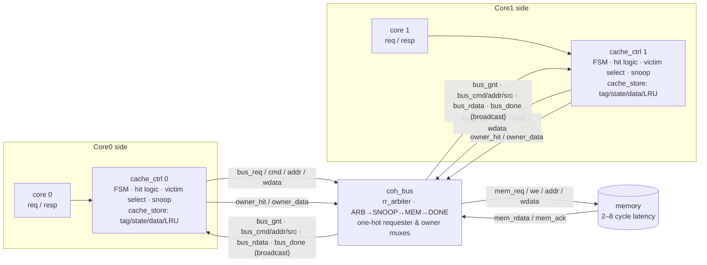

# MSI Snooping Cache Coherence (Verilog + UVM)

An N-core snooping **MSI cache-coherence** system in synthesizable Verilog: N
private write-back caches on one atomic shared bus in front of a flat memory.
It is verified with a UVM testbench, SVA checkers attached with `bind`, functional
coverage, and a mutation regression.

**Results (N=2 cores, 2-way caches):**
- **Regression:** 100 runs (5 traffic modes × 20 seeds) and 200,000 accesses, 0 errors.
- **Coverage:** 27/27 coverage bins hit, including both race bins.
- **Mutations:** all 6 injected bugs caught. Two of them never corrupt any data and are caught only by the latency and LRU assertions.
- **Latency:** worst case 53 cycles, equal to the derived bound K = 53.
- **FPGA:** 3,240 LUTs, 724 FFs, 70.8 MHz on an Artix-7.

## Architecture



| Parameter | Value |
|---|---|
| Cores `N` | 2 (parameter; scaling is an instantiation change) |
| Ways | 2 (1 also supported), LRU replacement, invalid ways used first |
| Sets × line | 4 × 16 B (4 × 32-bit words), whole line in one bus beat |
| Address | `[31:6]` tag · `[5:4]` index · `[3:2]` word |
| Hit latency | 1 cycle |
| Memory latency | random 2–8 cycles per transaction (testbench model) |

**Protocol rules** (each one is an invariant that the checkers enforce):
- **Atomic bus.** One transaction is in flight from grant to `bus_done`, so there are no transient states.
- **Upgrades refetch data.** S→M always uses `BusRdX` with data; there is no `BusUpgr`.
- **Owner supplies data.** On a snooped `BusRd`, the M owner provides the line and writes memory, so every S line always equals memory.
- **Decide at grant.** The requester chooses its transaction when it gets the bus, from its current state, not when the core asks.
- **Snoops beat local accesses.** While another cache's transaction is on a set, local hits to that set wait.
- **State commits at `bus_done`.** All state changes happen on that cycle.
- **LRU moves only on real use.** It advances only on local hits and completed fills.

## Verification

```
tb_top ── core_if × N ── core_agent × N (sequencer, driver, monitor) ──┐
       ── bus_if ──────── bus_monitor (stats)                          ├─ coh_env ── coh_scoreboard
       ── coh_bind ────── cache_checker (bound into every cache_ctrl)  │   (flat-memory reference,
       ── system_checker (cross-cache SVA, hierarchical refs)          │    end-of-test coherent check)
       ── mem_model (random latency, shared mem_init function)
```

- **Scoreboard.** A flat-memory reference model, updated when a store completes and checked on every load completion. Untouched words are checked too, using a deterministic `mem_init` function. At end of test, every touched word's coherent value (the M copy if one exists, else memory) must equal the reference.
- **`cache_checker`, bound into each cache.** It checks:
  - no illegal state
  - no duplicate tags in a set
  - no local hit during another cache's transaction on that set
  - an LRU shadow checker: the victim is the lowest invalid way, otherwise not the most-recently-used way

  It also holds the covergroups:
  - state × event
  - dirty and silent evictions, upgrades, owner transfers, contention
  - two race bins
  - per-way bins
- **`system_checker`.** It checks:
  - single writer / multiple readers
  - every S line equals memory
  - at most one owner per transaction
  - grant is one-hot and held until `bus_done`
  - every request completes within **K** cycles
- **Latency bound.** K = 2N·(LAT_MAX + 5) + 1 = 53 for N=2. The derivation is in `tb/system_checker.sv`.
- **Pass rule.** Every check reports through `uvm_error`. A run passes only with `UVM_ERROR : 0` and `UVM_FATAL : 0`.

### Traffic modes

| Test | Address pool | Hit rate | Bus txn / access | Owner transfers / run | Avg latency (cycles) |
|---|---|---|---|---|---|
| `coh_private_test` | disjoint per core | 0.267 | 1.128 | 0 | 18.99 |
| `coh_share_test` | 2–4 hot lines, shared | 0.467 | 0.533 | 711 | 5.97 |
| `coh_conflict_test` | one set, 5 tags, shared | 0.281 | 0.925 | 396 | 11.79 |
| `coh_pingpong_test` | one line, 80% writes | 0.224 | 0.776 | 1299 | 5.37 |
| `coh_falseshare_test` | one line, each core its own word | 0.294 | 0.706 | 1027 | 6.19 |

Each row averages 20 seeds of 1,000 accesses per core at N=2 with 2 ways.

### Mutation regression

Each mutant is a bug placed behind an `ifdef MUT_<k>` in `rtl/`. A mutant counts as caught when at least one test × seed fails.

| # | Injected bug | Runs failed | First check to fire | Other checks that fired |
|---|---|---|---|---|
| — | none | **0 / 100** | — | — |
| 1 | No invalidation on snooped `BusRdX` | 80 / 100 | single-writer SVA | scoreboard (stale loads) |
| 2 | M owner silent on snooped `BusRd` | 80 / 100 | S == memory SVA | scoreboard |
| 3 | Transaction chosen at request, not grant | 80 / 100 | scoreboard / victim checker | race bins hit in the same runs |
| 4 | Fixed-priority arbiter | 20 / 100 | **latency SVA only** (73 > K = 53) | none: data stays correct |
| 5 | Dirty victim writeback skipped | 40 / 100 | scoreboard | — |
| 6 | LRU not updated on hit | 40 / 100 | **LRU checker only** | none: data stays correct |

**6 / 6 caught.** Mutants 4 and 6 never produce a wrong value, so a data-only testbench would pass them.

### Coverage

- **Merged over the regression:** 27/27 bins (100%).
- **Race bins:** a victim demoted M→S while its cache waited for the bus was hit 464 times. An S line invalidated while waiting to upgrade was hit 3,241 times.
- **Per run:** each run's covergroup % averages 76%, because each traffic mode targets one behaviour. `coh_conflict_test` alone reaches 100%.

## Synthesis

| Tool | Target | Result |
|---|---|---|
| Yosys 0.68 | generic | 0 latches, 0 warnings, 16,195 cells, 3,182 FFs |
| Vivado 2025.1 | xc7a100tcsg324-1 (out of context, routed) | 3,240 LUTs (832 as distributed RAM), 724 FFs, 0 BRAM/DSP, **70.8 MHz** |

## Running

Requirements: Vivado 2025.1 (`xvlog`/`xelab`/`xsim`, with UVM) and Yosys (oss-cad-suite) on `PATH`.

```powershell
. "C:\tools\oss-cad-suite\environment.ps1"
$env:PATH = "C:\Xilinx\2025.1\Vivado\bin;" + $env:PATH

.\scripts\regress.ps1      # everything: 7 builds x 5 tests x 20 seeds, results table (~10 min)
```

Individual steps:

```powershell
.\scripts\phase0.ps1       # toolchain probe: UVM, covergroup, SVA, bind, hier-ref
.\scripts\smoke.ps1        # directed single-cache smoke test (xsim) + Yosys latch/loop check
.\scripts\phase2.ps1       # UVM env at N=1: 5 tests x 20 seeds

# Build the default snapshot (N=2, WAYS=2) and run tests x seeds in parallel
xvlog -f sim/rtl.f; xvlog -sv -L uvm -f sim/tb.f
xelab tb_top -L uvm -s coh_sim -timescale 1ns/1ps -debug typical
.\scripts\run_tests.ps1 -Snapshot coh_sim -Tests coh_share_test,coh_pingpong_test -Seeds (1..20)

# One run
xsim coh_sim -R -testplusarg "`"UVM_TESTNAME=coh_share_test`"" -sv_seed 7

# FPGA numbers
vivado -mode batch -nojournal -log results/vivado/vivado.log -source impl/synth.tcl
```

On Windows, arguments that contain `=` must be passed to `xsim` and `xelab` inside
embedded quotes, as shown above. Override `N` or `WAYS` with
`xelab ... -generic_top "`"N=1`""`.

## Layout

| Path | Contents |
|---|---|
| `rtl/` | `coh_defs.vh`, `cache_store.v`, `cache_ctrl.v`, `rr_arbiter.v`, `coh_bus.v`, `coh_top.v` (mutations behind `ifdef MUT_<k>`) |
| `tb/` | `tb_top.sv`, `core_if.sv`, `bus_if.sv`, `mem_model.sv`, `mem_init.svh`, `cache_checker.sv`, `system_checker.sv`, `coh_bind.sv`, `tb_smoke.sv`, `phase0/` |
| `tb/uvm/` | `coh_pkg.sv` with transaction, sequences, driver, monitor, agent, bus monitor, scoreboard, env and tests |
| `sim/` | `xvlog` file lists |
| `scripts/` | gate scripts, `run_tests.ps1` (parallel runner), `regress.ps1` (mutation regression) |
| `impl/` | Vivado out-of-context script and constraints |
| `ENGINEERING_LOG.md` | decisions, bugs, gate results and measurements |
